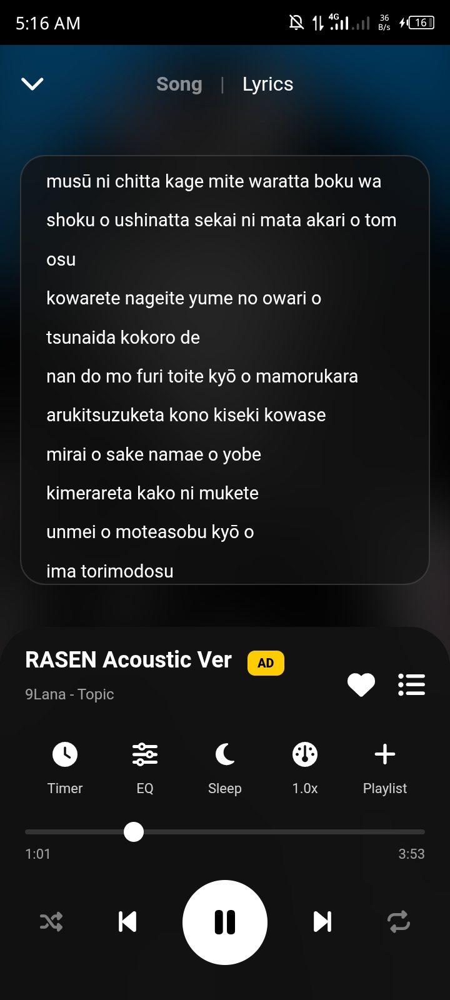
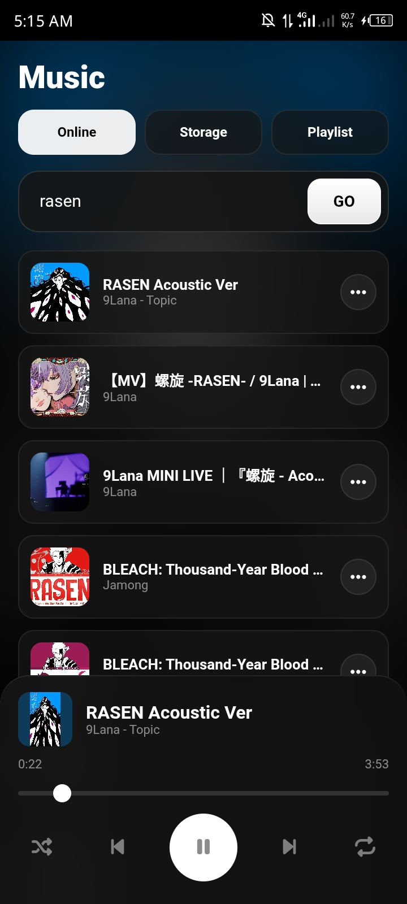

# 🎵 Music Player V1.0.2

Music player offline/online simple, bisa ganti judul, artis langsung di HP.

### 📥 Download APK

| Versi | Apa yang baru | Download | Tanggal |
| :--- | :--- | :---: | :---: |
| **V1.0.2 (Latest)** | + Fitur ganti judul, fix UI | [**Download**](https://github.com/teddycihuyy/Music-Player/releases/download/v1.0.2/MusicPlayer.V1.0.2.apk) | 2 Nov 2026 |
| V1.0.1 | Versi awal busuk njir | [Download](https://github.com/teddycihuyy/Music-Player/releases/download/v1.0/MusicPlayerBeta.apk) | 31 Okt 2026 |

> Selalu download yang **Latest** ya. Yang lama buat cadangan aja kalo yang baru error.

---

### ✨ Fitur

- ✅ Play lagu offline dari storage
- ✅ Ganti Judul Lagu (klik :)
- ✅ Ganti Artis
- ✅ Timer, EQ, Speed (NEW)
- ✅ UI Dark, ringan

### 📸 Preview

  
  
  

  Tap titik 3 untuk edit lagu • Tampilan player • Daftar lagu offline

---

### 🚀 Cara Install

1. Klik badge Download APK di atas
2. Buka file APK di HP
3. Izinkan "Install dari sumber tidak dikenal" kalo diminta
4. Selesai!

Atau langsung coba versi Web: **https://teddycihuyy.github.io/Music-Player-V1.0.2/**

---
Made with ❤️ by @teddycihuyy
